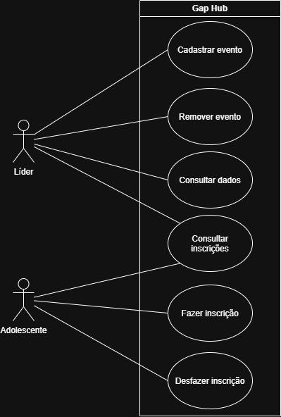

# 4.2.2 Modelagem de Casos de Uso

## Atores

| Ator | Quem é | O que faz no sistema |
|---|---|---|
| Líder | participante da liderança do Gap | cadastra e remove eventos, e visualiza os dados de cada adolescente |
| Adolescente | adolescente participante do Gap | realiza sua inscrição em eventos |

## Casos de uso

| Caso de uso | Ator | Atende |
|---|---|---|
| Cadastrar evento | Líder | RF01 |
| Remover evento | Líder | RF02 |
| Consultar inscrições | Líder e Adolescente (qualquer usuário pode ver as inscrições) | RF03 |
| Consultar dados | Líder | RF04 |
| Fazer inscrição | Adolescente | RF05 |
| Desfazer inscrição | Adolescente | RF06 |

## Diagrama de casos de uso

**Figura 1 – Diagrama de casos de uso do Gap Hub**

Fonte: Autoria própria (2026).

A figura mostra a fronteira com o nome do sistema e 2 atores do lado de fora. O Adolescente se liga a Fazer inscrição e Desfazer inscrição. Já o Líder se liga com todos os outros. Ambos os atores se ligam com Consultar inscrições.

## Especificação do caso de uso principal

Fazer inscrição é o caso de uso que o sistema existe para fazer: com ele fica mais fácil saber antecipadamente quem vai em cada evento. Por isso é especificado.

| Campo | |
|---|---|
| Caso de uso | Fazer inscrição |
| Ator | Adolescente |
| Pré-condição | O evento está cadastrado (RF01) |
| Pós-condição | O adolescente aparece inscrito no evento (RF03) |

**Fluxo principal**

1. O adolescente entra no sistema usando seu nome e número do sistema.
2. O sistema exibe os eventos disponíveis.
3. O adolescente se inscreve no evento que deseja participar.
4. O sistema registra a inscrição com o nome do adolescente no evento selecionado e calcula quando precisa enviar o aviso de data para o adolescente.

**Fluxo alternativo**

- **A1, no passo 3: o adolescente já está inscrito no evento.** O sistema informa que o adolescente já está inscrito e exibe novamente os eventos disponíveis; o fluxo volta para o passo 2.

## Rastreabilidade com a 4.2.1

<!-- Todo RF da sua 4.2.1, um por linha. Diga a elipse que o atende ou, se ele não virou elipse, onde ele mora.
     Depois responda as três perguntas. -->

| Requisito | Caso de uso | Onde aparece |
|---|---|---|
| RF01 Cadastrar evento | Cadastrar evento | elipse, pré-condição de Fazer inscrição |
| RF02 Remover evento | Remover evento | elipse |
| RF03 Consultar inscrições | Consultar inscrições | elipse, pós-condição de Fazer inscrição |
| RF04 Consultar dados | Consultar dados | elipse |
| RF05 Fazer inscrição | Fazer inscrição | elipse, especificação |
| RF06 Desfazer inscrição | Desfazer inscrição | elipse |
| RF07 Avisar data de evento | nenhuma elipse | passo 4 do fluxo principal |
| RF08 Exibir eventos | nenhuma elipse | passo 2 do fluxo principal |

Todo requisito tem lugar? Sim.
Toda elipse tem requisito? Não. Alguns requisitos não moram em elipses mas sim em partes do fluxo principal.
