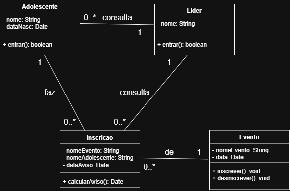
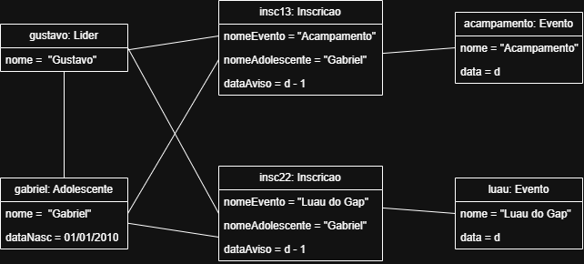

# 4.2.3 Modelagem de Classes

## Dos substantivos às classes

| Substantivo | De onde veio | Vira | Por quê |
|---|---|---|---|
| adolescente | ator do 4.2.2 | classe **Adolescente** | o sistema guarda quem ele é e em quais eventos se inscreveu |
| líder | ator do 4.2.2 | classe **Lider** | o sistema precisa saber quem pode cadastrar e remover eventos |
| nome | passo 4 do fluxo principal | atributos de **Adolescente** e **Lider** | o sistema usa esse atributo para entrar no usuário correto (adolescente ou  líder) |
| evento | passo 3 do fluxo principal | classe **Evento** | a classe central do sistema: é através dela que são registradas as inscrições |
| inscrição | passo 3 do fluxo principal | classe **Inscricao** | registro que surge de um evento, guarda qual evento, o nome de quem se inscreveu, e a data do aviso de evento |
| data do aviso de evento | passo 4 do fluxo principal | atributo de **Inscricao** | surge decorrente da inscrição, não existe sem ela

## Classes

| Classe | Atributos | Operações | Veio de |
|---|---|---|---|
| **Adolescente** | - nome: String, - dataNasc: Date | + entrar(): boolean | passo 1 do fluxo principal |
| **Lider** | - nome: String | + entrar(): boolean | RNF02 (só o líder cadastrar e remove eventos) |
| **Evento** | - nomeEvento: String, - data: Date | + inscrever(): void, + desinscrever(): void | RF05 (fazer inscrição) e RF06 (desfazer inscrição) |
| **Inscricao** | - nomeEvento: String, - nomeAdolescente: String, - dataAviso: Date, - nomeAdolescente: String | + calcularAviso(): Date | passo 4 (registro do nome), RF07 (cálculo do aviso) |

## Diagrama de classes

**Figura 2 – Diagrama de classes do Gap Hub**

Fonte: Autoria própria (2026).

A Figura 2 mostra as classes do Gap Hub com seus atributos e métodos e suas associações. Seguem-se as explicações de cada uma delas:
1. Um **Adolescente** faz zero ou várias **Inscricao**
2. Um **Lider** consulta zero ou várias **Incricao**
3. Um **Lider** consulta os dados de zero ou vários **Adolescente**
4. Cada **Inscricao** é de exatamente um **Evento**

## Teste de objetos

**Figura 3 – Diagrama de teste de objetos do Gap Hub**

Gabriel se inscreveu para o Luau do Gap, e já havia se inscrito um mês antes para o Acampamento, o líder Gustavo consultou as inscrições desses evento, e a data de nascimento do Gabriel, para saber sua idade que seria usada para definir os times de uma gincana.

| Objeto | Classe | Valores |
|---|---|---|
| gustavo | Lider | nome = "Gustavo" |
| gabriel | Adolescente | nome = "Gabriel", dataNasc = 01/01/2010 |
| acampamento | Evento | nome = "Adolescente", data = 09/10/2026 |
| luau | Evento | nome = "Luau do Gap", data = 20/10/2026 |
| insc13 | Inscricao | nomeEvento = "Acampamento", nomeAdolescente = "Gabriel", dataAviso = 09/10/2026 - um dia |
| insc22 | Inscricao | nomeEvento = "Luau do Gap", nomeAdolescente = "Gabriel", dataAviso = 20/10/2026 - um dia |

**Ligações:** gustavo e gabriel, gustavo e insc13, gustavo e insc22, gabriel e insc13, gabriel e insc22, insc13 e acampamento, insc22 e luau.

**O que o teste confirma**

- **Um adolescente faz várias inscrições**. O gabriel aparece ligado a duas **Inscricao**.
- **Um líder consulta várias inscrições**. O gustavo aparece ligado a duas **Inscricao**.
- **Um líder consulta dados de um adolescente**. O gustavo aparece ligado ao gabriel um **Adolescente**, para consultar dataNasc.
- **Cada inscrição é de apenas um evento**. Aparecem duas inscrições no diagrama, porém cada uma está ligada a apenas um **Evento**.

## Rastreabilidade com a 4.2.2

<!-- Toda operação e os atributos principais, um por linha, com o passo do fluxo ou o requisito que a pede.
     Depois responda as três perguntas. -->

| Operação ou atributo | Classe | De onde veio |
|---|---|---|
| entrar() | Adolescente e Lider | passo 1 do fluxo (login do adolescente), RNF02: mostra que é necessário haver uma forma de login para diferenciar um adolescente de um líder |
| inscrever(), desinscrever() | Evento | RF05: fazer inscrição (inscrever), e RF06: desfazer inscrição (desinscrever) |
| calcularAviso() | Inscricao | passo 4 do fluxo, RF07: mostra a necessidade de calcular a data do aviso |
| dataAviso | Inscricao | passo 4 e RF07, é necessário um lugar para armazenar a data do aviso |

Toda operação tem origem? Sim
Todo passo do sistema tem casa? Sim
