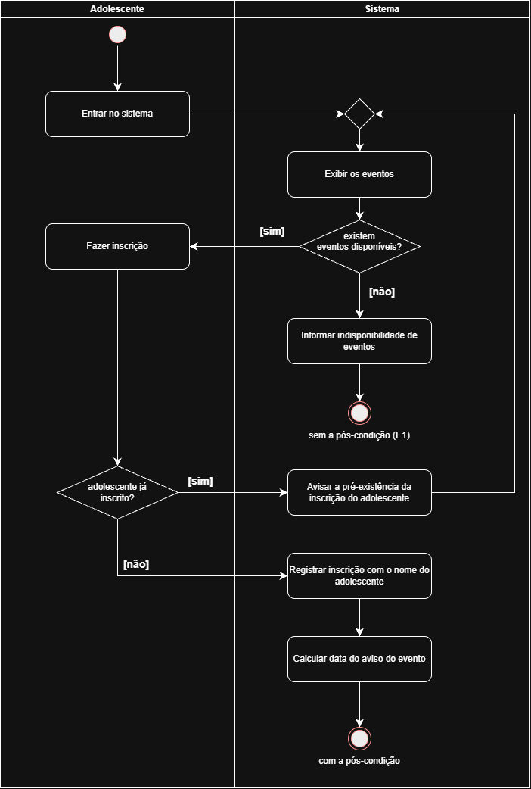

# 4.2.5 Modelagem de Atividade

## Do fluxo ao diagrama

| No fluxo da 4.2.2 | Vira | Raia | Por quê |
|---|---|---|---|
| passo 1: o adolescente entra no sistema | ação **Entrar no sistema** | Adolescente | quem age é o ator, portanto a ação fica na raia dele |
| passo 2: o sistema exibe os eventos | ação **Exibir os eventos**, e uma decisão: existem eventos disponíveis? | Sistema | um passo onde com uma conferência que esconde uma pergunta. É dessa pergunta que sai E1 |
| E1: o sistema não encontra eventos disponíveis | saída [não] da decisão, ação **Informar indisponibilidade de eventos** e um fim próprio | Sistema | quando é uma exceção não há retorno no fluxo, mas um fim próprio |
| passo 3: o adolescente se inscreve no evento | ação **Fazer inscrição**, e uma decisão: adolescente já está inscrito no evento? | Adolescente | ação do ator, possui uma pergunta que origina A1 |
| A1: o sistema verifica que o adolescente já está inscrito no evento | saída [sim] da decisão, ação **Avisar a existência da inscrição do adolescente** e uma junção antes de Exibir os eventos | Sistema | por ser um fluxo alternativo existe um desvio que volta para o fluxo principal, o ponto de encontro é a junção |
| passo 4: ação **Registrar inscrição com o nome do adolescente**, ação **Calcular data do aviso do evento** e o fim do fluxo principal | passo com duas ações, e que marca o fim do fluxo com a pós-condição | 

## Diagrama de atividades

<!-- Desenhe no draw.io. Duas raias, uma para o ator e uma para o sistema. Círculo cheio no início, alvo no fim.
     Ação em retângulo arredondado, com verbo no infinitivo. Decisão em losango com a pergunta dentro e [sim] e [não] nas saídas. Junção é o losango sem pergunta.
     Salve diagramas/atividade.drawio e exporte diagramas/atividade.png. Legenda acima, fonte abaixo, e a figura descrita no texto. -->

**Figura _N_ – Diagrama de atividades de _Nome do caso de uso_**

Fonte: Autoria própria (2026).

_Descreva a figura. As raias e quem está em cada uma, e o caminho do início ao fim feliz. Depois cada decisão, para onde vai cada saída, e por que há o número de fins que há._

## Rastreabilidade com a 4.2.2

<!-- Cada ação e cada saída de decisão, com o passo, o alternativo ou a exceção de onde veio.
     Depois responda as três perguntas. -->

| Elemento do diagrama | Vem de | Confere |
|---|---|---|

_Todo passo tem elemento? Toda decisão tem as duas saídas? O que o desenho mudou na sua especificação?_# 4.2.5 Modelagem de Atividade

<!--
Esta seção responde: como o caso de uso principal acontece, do início ao fim, com quem faz o quê e o que muda em cada decisão?

São três blocos, na ordem em que aparecem. Desta vez as tabelas vêm só com o cabeçalho: você já fez isso na 4.2.2 e na 4.2.3.
O diagrama é do caso de uso que você especificou na 4.2.2. Um diagrama, até o teto: 6 a 12 ações, 1 a 3 decisões, 2 raias.

Ele vai em dois arquivos com o mesmo nome: diagramas/atividade.drawio (para editar) e diagramas/atividade.png (para aparecer aqui).
A numeração das figuras continua a da 4.2.3: se lá você chegou à Figura 2, aqui é a Figura 3.

A mesma seção pronta, do BiblioTech, está em exemplo-bibliotech/docs/4.2.5-atividade.md
no repositório do modelo, com o diagrama em exemplo-bibliotech/diagramas/. O BiblioTech mostra a forma. O fluxo tem de ser o seu.

Quando terminar, pode apagar estes comentários.
-->

## Do fluxo ao diagrama

<!-- Abra a sua especificação na 4.2.2. Cada passo vira uma ação, na raia de quem faz.
     Cada "o sistema confirma" ou "verifica" vira ação e decisão com pergunta. O alternativo volta por uma junção. A exceção termina num fim próprio. -->

| No fluxo da 4.2.2 | Vira | Raia | Por quê |
|---|---|---|---|

## Diagrama de atividades

<!-- Desenhe no draw.io. Duas raias, uma para o ator e uma para o sistema. Círculo cheio no início, alvo no fim.
     Ação em retângulo arredondado, com verbo no infinitivo. Decisão em losango com a pergunta dentro e [sim] e [não] nas saídas. Junção é o losango sem pergunta.
     Salve diagramas/atividade.drawio e exporte diagramas/atividade.png. Legenda acima, fonte abaixo, e a figura descrita no texto. -->

**Figura _N_ – Diagrama de atividades de _Nome do caso de uso_**

Fonte: Autoria própria (2026).

_Descreva a figura. As raias e quem está em cada uma, e o caminho do início ao fim feliz. Depois cada decisão, para onde vai cada saída, e por que há o número de fins que há._

## Rastreabilidade com a 4.2.2

<!-- Cada ação e cada saída de decisão, com o passo, o alternativo ou a exceção de onde veio.
     Depois responda as três perguntas. -->

| Elemento do diagrama | Vem de | Confere |
|---|---|---|

_Todo passo tem elemento? Toda decisão tem as duas saídas? O que o desenho mudou na sua especificação?_
